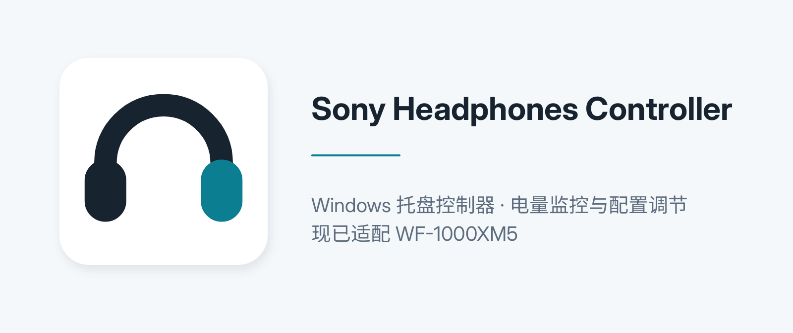

<p align="center">
  
</p>

<p align="center">
  <a href="https://github.com/windfsy/SonyHeadphonesController/releases/latest"></a>
  <a href="LICENSE"></a>
  <a href="https://github.com/windfsy/SonyHeadphonesController/actions/workflows/ci.yml"></a>
  
  
</p>

Windows 托盘常驻控制器，为 Sony WF-1000XM5 提供 Sound Connect 的核心功能：ANC 切换与电量查看，弥补官方 app 不支持 Windows 的空白。

控制通道基于对 Sound Connect (Android) v13.3.0 APK 的逆向分析实现——Sony MDR v2 协议走明文 RFCOMM，无需 root、无需中间人代理，直连耳机。协议细节见 [docs/PROTOCOL_NOTES.md](docs/PROTOCOL_NOTES.md)，需求规格见 [docs/SPEC.md](docs/SPEC.md)。

## 功能

- **系统托盘常驻**：托盘图标实时显示电量，悬停显示设备与连接状态
- **自动连接**：耳机连上电脑时自动建立控制通道，断开时静默退避重连
- **控制面板**：
  - 顶部展示与设备颜色一致的官方产品图（黑色/银色/粉色）
  - 左耳 / 右耳 / 充电盒三体电量 + 充电状态
  - ANC 三态切换：降噪 / 通透 / 关闭
  - 通透等级 0-20 滑条 + 「关注语音」开关
- **状态同步**：耳机主动推送（NTFY）+ 打开面板全量拉取 + 15 秒兜底刷新；手机端 Sound Connect 改 ANC，电脑端自动跟上
- **命令防护**：校验 + 单次重试，两次失败显示"耳机无响应"

## 下载安装

1. 从 [Releases](https://github.com/windfsy/SonyHeadphonesController/releases/latest) 下载 `SonyHeadphonesController-<版本>-win-x64.zip`
2. 解压到任意目录，运行 `SonyHeadphonesController.exe`（无安装程序、不写注册表）
3. 首次运行选择已配对的耳机即可，配置存于 `%APPDATA%\SonyHeadphonesController\config.json`

> 托盘图标本身是**电量徽章**（按电量着色、显示百分比），因此与程序图标不同——这是为了让电量在不打开面板时也可见。

## 运行要求

| 项 | 要求 |
|---|---|
| 系统 | Windows 10/11（x64） |
| 设备 | WF-1000XM5（其他 MDR v2 机型见「已知限制」） |
| 运行时 | [.NET 10 桌面运行时](https://dotnet.microsoft.com/download/dotnet/10.0)（framework-dependent 发布） |
| 前置 | 耳机已与电脑完成蓝牙配对 |

## 使用

首次运行会弹出设备选择窗口（列出 Windows 已配对的蓝牙设备），选中 WF-1000XM5 后自动保存配置。

日常使用：耳机连上电脑 → 托盘图标变彩色电量 → 左键点开控制面板调节。

## 排障

| 现象 | 说明 |
|---|---|
| 托盘灰色 `-` | 耳机未连电脑；把耳机从充电盒取出或从暂停恢复连接即可 |
| 连接失败反复重试 | 耳机控制通道被其它设备占用（如手机 Sound Connect 连接中），释放后自动恢复 |
| 面板"耳机无响应" | 命令两次未获回应；等数秒重试，或重新开合充电盒让耳机重新协商 |
| 需要更多线索 | 诊断日志在 `%TEMP%\SonyHeadphonesController.diag.log` |

## 已知限制

- 单目标设备，不做多设备管理
- 开机自启动未实现
- 仅经典蓝牙 RFCOMM 通道（BLE GATT 预留为后续扩展）
- 音量控制不在设计范围（Windows 音量键已足够）
- 协议实现针对 WF-1000XM5 真机验证，其他机型可能部分可用

## 开发

```
SonyHeadphonesController/
├── assets/         # 项目图标 + README 主图
├── docs/           # 需求规格 + 协议逆向笔记 + 诊断脚本
├── src/
│   └── SonyHeadphonesController/
│       ├── Assets/        # app.ico（exe/窗口图标）
│       ├── Transport/     # 蓝牙传输层：AF_BTH RFCOMM socket + 配对设备枚举
│       ├── Mdr/           # Sony MDR v2 协议层：帧编解码 + 命令收发 + ACK/序列号
│       ├── App/           # 应用层：连接状态机 + 设备事件监听 + 命令防护
│       └── UI/            # WPF：托盘 + 控制面板 + 设备选择 + ViewModel
└── SonyHeadphonesController.sln
```

```bash
dotnet build SonyHeadphonesController.sln        # 要求零警告
dotnet publish src/SonyHeadphonesController -c Release -o publish
```

没有测试项目：协议与 UI 行为依赖真机验证，改动后请实机确认。架构分层与约定见 [AGENTS.md](AGENTS.md)。

欢迎贡献，见 [CONTRIBUTING.md](CONTRIBUTING.md)；变更记录见 [CHANGELOG.md](CHANGELOG.md)；安全问题请按 [SECURITY.md](SECURITY.md) 私下报告。

## 参考

- 协议逆向笔记：[docs/PROTOCOL_NOTES.md](docs/PROTOCOL_NOTES.md)（含 APK 反编译证据索引）
- 社区参考：mos9527/SonyHeadphonesClient、whitebeard10/SonyCompanionApp、ohm-app/sony-headphones-bluetooth-documentation

## 许可

[MIT](LICENSE) © 2026 wind.sy

本项目与 Sony 无隶属关系；"Sony"、"WF-1000XM5"、"Sound Connect" 为其各自权利人的商标，仅用于说明兼容性。
